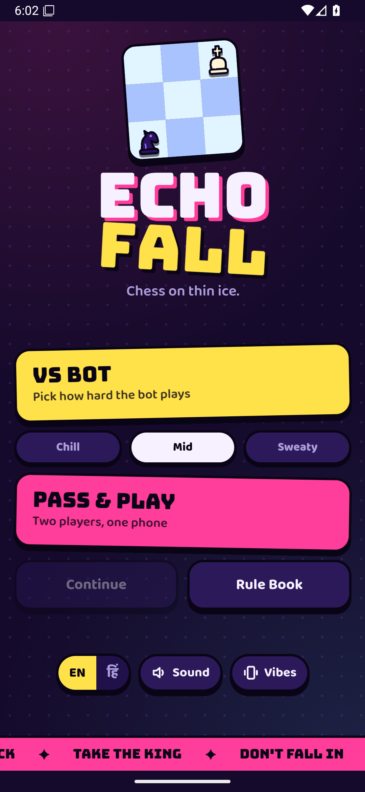
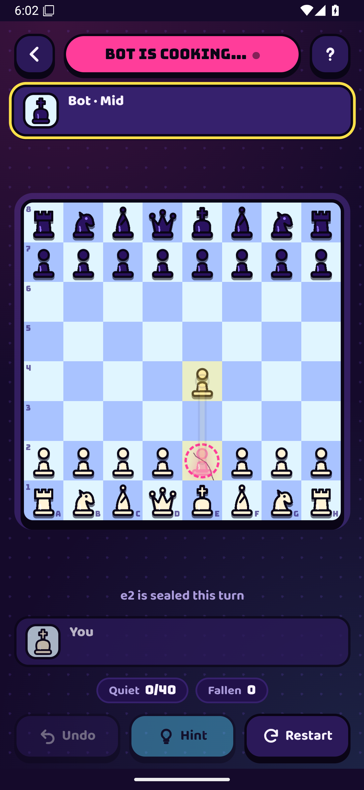

# Echofall

**Chess on thin ice.** A new chess variant where the board breaks under you.

Pieces move like normal chess, but every square you leave is sealed behind you for one turn, and it cracks. Leave a square three times and it falls into the water for good. There is no check: capture the king to win.

<p>
  
  
</p>

## Download

Get the Android app from the [latest release](../../releases/latest): download `Echofall.apk`, open it on your phone and allow installs from unknown sources. It needs Android 8.0 or newer.

## Rules

| Rule | What it does |
| --- | --- |
| **Echo** | When a piece moves, the square it left is sealed for your opponent's next move. They can't land on it or slide through it. Knights can still jump over it. |
| **Crack** | Every time a piece leaves a square, the ice cracks. Standing on a square never hurts it. Only leaving does. |
| **Fall** | On the third departure the square becomes a hole forever. Nothing can land on a hole or slide across it. Knights jump over. |
| **Crown** | No check, no checkmate. Capture the king to win. A player with no legal move loses. 40 moves each without a capture is a draw. |

No castling and no en passant. Pawns promote to queens.

**Ideas to try**
- **The seal:** move a blocker out of a line. Its echo still blocks that line for one turn, so your opponent can't block your new attack along it.
- **The moat:** break the ice around the enemy king until it has nowhere to step.
- **Thin ice:** a piece on a twice-cracked square is safe until it moves, then the square falls behind it.

The full rule book is in the app in English and Hindi (हिंदी).

## What's in this repo

| Folder | Contents |
| --- | --- |
| `www/` | The Android app's game: HTML, CSS and JavaScript (engine, bot, animations, English and Hindi text) |
| `android/` | The native Android shell: manifest, launcher icon and `MainActivity.java` (WebView, vibration, Back button) |
| `web/` | A standalone web version with Vs machine, two players and **Bot vs bot** mode with match and series stats |
| `build.sh` | Builds the APK with the Android SDK tools directly, no Gradle |

### Play the web version

Open `web/index.html` in any browser.

### Build the APK

Needs JDK 17+, Python 3 and the Android SDK (build-tools 36.0.0, platform android-35).

```bash
bash build.sh
# -> out/Echofall.apk
```

The first build creates a signing key at `android/echofall.keystore` with its password in `android/keystore.pass`. Both are git-ignored. Keep them safe: updates to an installed app must be signed with the same key.

## Credits

Fonts: [Bungee](https://github.com/djrrb/Bungee) and [Baloo 2](https://github.com/EkType/Baloo2), both under the SIL Open Font License (see `www/fonts/`).
